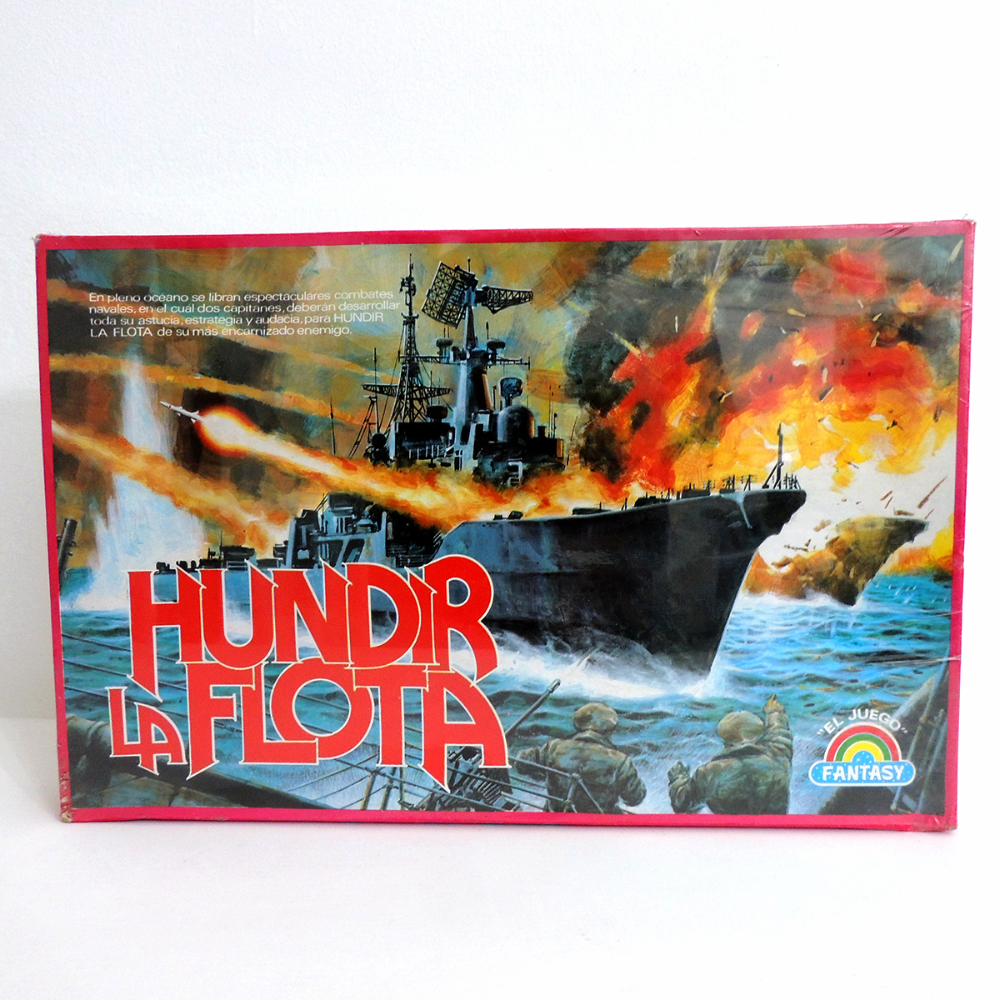

# **BATALLA DE PEARL HARBOR**

##  <u> *Instrucciones*</u>

Nos encontramos a finales de noviembre de 1941 en las inmediaciones de las islas de Hawaii. Estados Unidos se ha enterado de un ataque inminente por parte del país Nipon. Ante esta situación, los estadounidenses tratarán de destruir los portaaviones japoneses con sus acorazados. Pero, ¿podrán conseguirlo?, o ¿volverá a repetirse la historia?.

Para conseguir este objetivo, tanto estadounidenses (jugador) como japoneses (ordenador) contarán con dos tableros de dimensiones 10x10 cada uno. En un tablero, los estadounidenses/japoneses colocarán en secreto sus acorazados/portaviones. Mientras, que el otro tablero, les servirá para saber en dónde han disparado y si han alcanzado a la flota enemiga.

Los estadounidenses cuentan con los siguientes acorazados: USS Arizona (eslora = 5), USS Oklahoma (eslora = 4), USS Nevada (eslora = 3), USS Missouri (eslora = 3), y el USS Utah (eslora = 2). Mientras que los japoneses cuentan con los siguientes portaaviones: Akagi (eslora = 5), Shokaku (eslora = 4), Kaga (eslora = 3), Hiryu (eslora = 3), y Soryu (eslora = 2).

1. ***Colocación de los barcos:*** Cada jugador debe colocar sus barcos en secreto en su tablero. Los barcos sólo pueden colocarse en horizontal o vertical, pero no en diagonal. Tampoco pueden solaparse entre sí.
El jugador será quien primero cree sus barcos y los coloque en su tablero. Las entradas de coordenadas de los barcos cuando se crean deben tener el siguiente formato: *número,número*

Después, el ordenador creará sus barcos de forma aleatoria y los posicionará en su tablero.

2. ***Turnos:*** Los jugadores se turnan para disparar la flota enemiga, anunciando una coordenada en el tablero del oponente. Si el disparo impacta en un barco enemigo, el oponente debe anunciar "¡Tocado!" y el atacante marca la casilla como "X". Si por el contrario, el disparo cae en el agua, el oponente anuncia "¡Agua!", y el atacante marca esa casilla como una "a".

3. ***Ganar:*** El jugador que logre destruir toda la flota enemiga, no le queden más "O", gana la partida.
